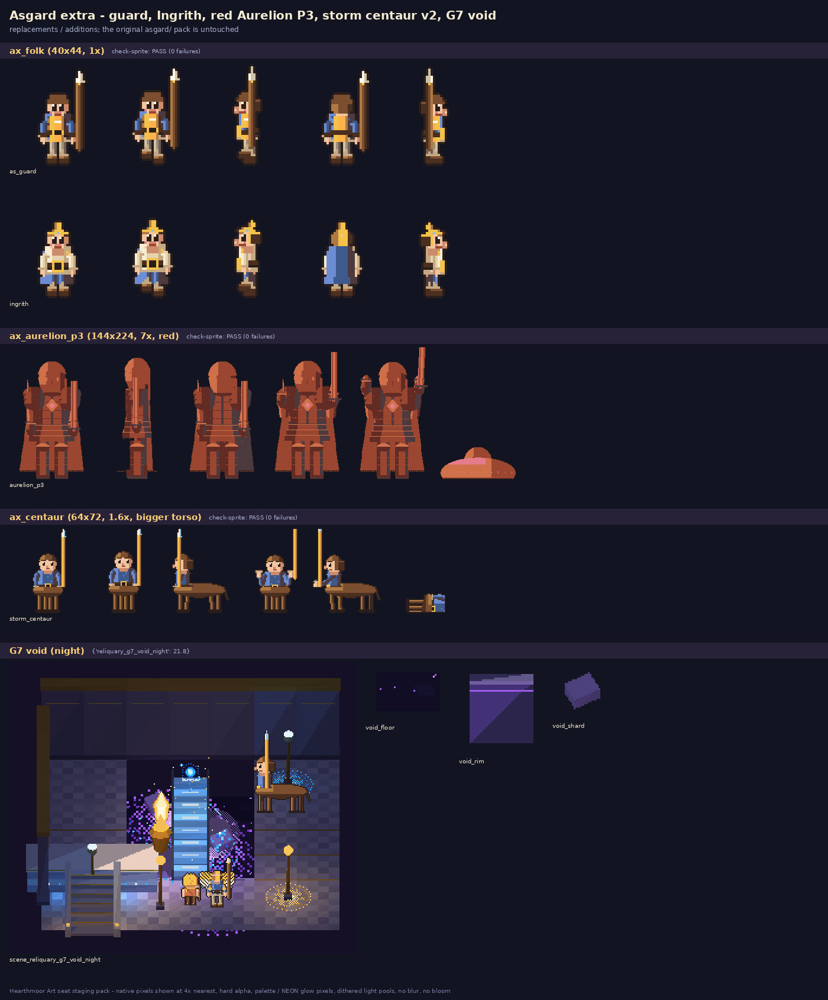

# Asgard extra (follow-up to `asgard/`, which is untouched)

Art seat, 2026-10-20. Rebuild: `cd src && python3 gen_extra.py && python3 void_g7.py && python3 contact_extra.py`.

| file | roles | frame / grid |
|---|---|---|
| `sprite/ax_folk` | `as_guard` (1x): storm-blue tunic, leather jerkin under a gilded tabard, belted grey trousers, boots, leather cap, bracers, spear (light gear, no plate). `ingrith` (1x, Envoy Ingrith Goldrune per story §5 roster): cream tunic, belted blue trousers, gold buckle, boots, gold-pinned blue cloak, gold circlet | 40x44, same as `as_folk` (idle 0-3, walk 4-7) |
| `sprite/ax_aurelion_p3` | `aurelion_p3` REPLACEMENT: plate, cape, blade and face remapped to the red ramp (mostly #9a4630 / #622c24 / #d0704a, rose #e47c8c seams + eyes, #4c3a3e shade); light #e8321e | 144x224, same grid as `boss_aurelion` (idle/walk/cast/attack/die) |
| `sprite/ax_centaur` | `storm_centaur` REPLACEMENT with a bigger human torso (upper body 1.08x ht, was 0.78x) | 64x72, same grid as `as_enemies` |
| `kit/` | `void_floor`, `void_rim`, `void_shard` (+ kit.json markers) | G7 void |
| `gamefx/as_fx` | the full asgard fx set + `void_motes`, `void_pool`, `void_shade` (mid-dark #4a3a66 / #5e4c80) | 48 px; superset replacement of `asgard/gamefx/as_fx` |
| `renders/` | `scene_reliquary_g7_void_night.png` (luma in `luma.json`), void piece renders | |

Engine use: replace the `aurelion_p3` role with `ax_aurelion_p3`, and the `storm_centaur` role with `ax_centaur`.

## G7 void placement
`void_floor` tiles go 2.4 m below walk level where the floor is missing, under the rune bridge. `void_rim` sits on the drop edges. `void_shard` pieces float at y -1.5 to -0.6, at least 1.5 m from the bridge. Violet lights and `void_pool` / `void_motes` stay in the void; nothing sits on the bridge, the stairs or the ledge edges.

## Check-sprite (once per sheet)
ax_folk PASS, ax_aurelion_p3 PASS, ax_centaur PASS (0 failures). Details: `check_sprite_report.json`.

## Neon
No sprite uses neon, so no twins and no allow-list entries. Neon appears only in fx and the kit glow material (#a45cf0, #d4a8ff).

The red P3 uses the palette's deepest reds, because the palette has no true crimson. For a neon crimson twin, the scoped allow-list entry would be role `aurelion_p3` with #8e0f24, #c41a2e and #ff4a3a. Say if you want it.

## Notes / questions
- In G7, the ledge brazier is close to the void lip. Should it move back?
- `ingrith` duplicates the existing `envoy_as` role (same character), adding boots and a circlet. Which one should the game use?
