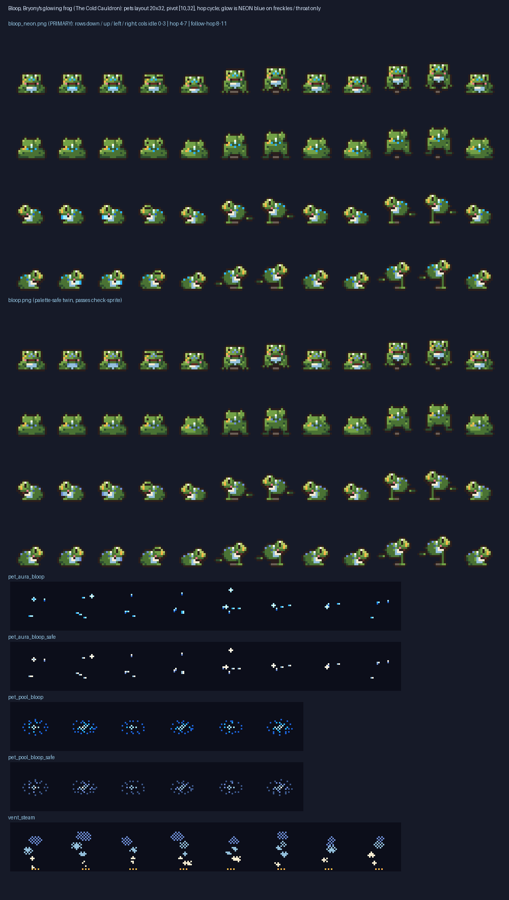

# Bloop, Bryony's glowing frog (The Cold Cauldron, story 7.6)

A small teal-green frog with a pale belly, shy eyes, a tiny smile and **cold-blue glowing freckles** on his brow, back and throat, with a touch of amber forge light on one side. Cute and clean. Rebuild: `cd src && python3 bloop_gen.py` (reuses `art/pets/pets_gen.py`, repo read-only).

| file | what |
|---|---|
| `bloop_neon.png` (240x128) | **primary sheet**, role `pet_bloop` |
| `bloop.png` | palette-safe twin and fallback (same layout, **passes check-sprite**) |
| `bloop.json` | pets atlas format: frame 20x32, pivot [10,32], ground_row 31; `primary` = neon, `fallback` = safe; `petfx` has the light spec |
| `bloop_fx.png/json` | 32 px spells format: `pet_aura_bloop` (+`_safe`), `pet_pool_bloop` (+`_safe`), `vent_steam` (optional, amber underglow) |

**Layout:** 12 columns x 4 rows (down, up, left, right = mirror of left). Columns: idle 0-3 (breathing, throat glow, blink), walk/hop 4-7, follow/hop 8-11 (bigger hop). The frog is drawn small (about 12 x 9 px, up to 15 px tall mid-hop) at the bottom of the cell. A small shadow dash keeps the feet row on the ground in air frames.

**Light spec** (`bloop.json` role `petfx.light`): `#7fe0e8`, intensity 1.4, range 3.0 m, lift 0.3, gentle pulse 0.7-1.15 at 0.6 Hz; pool `pet_pool_bloop`, aura `pet_aura_bloop`.

**Placement:** talkable NPC. Put him on the flat by the Forge Quarter vents / Old Gurgle (after the quench-tank find), 1.5 m clear of the vent, stairs and spawn points; steam fx 1 m behind him. As a follower he hops (columns 8-11).

**check-sprite (once):** `bloop.png` PASS (0 failures, 15 colours). `bloop_neon.png` fails only on the neon colours until the lead adds a scoped `pet_bloop` allow-list entry, the same three neon-blue hexes as Tick and Flurry: `#1c62d8 #2ab4ff #a6ecff`. Report: `check_sprite_report.json`.

**Neon flag:** neon-blue pixels only on his freckles and throat in `bloop_neon.png`, and in `pet_aura_bloop` / `pet_pool_bloop`. The safe twins use palette colours only.

## Questions
1. Teal-green body with blue glow, or a fully blue frog like the quest text ("a blue frog surfaces in the cold fire")?
2. Add a `pet_bloop` allow-list entry, or ship only the safe twin?
